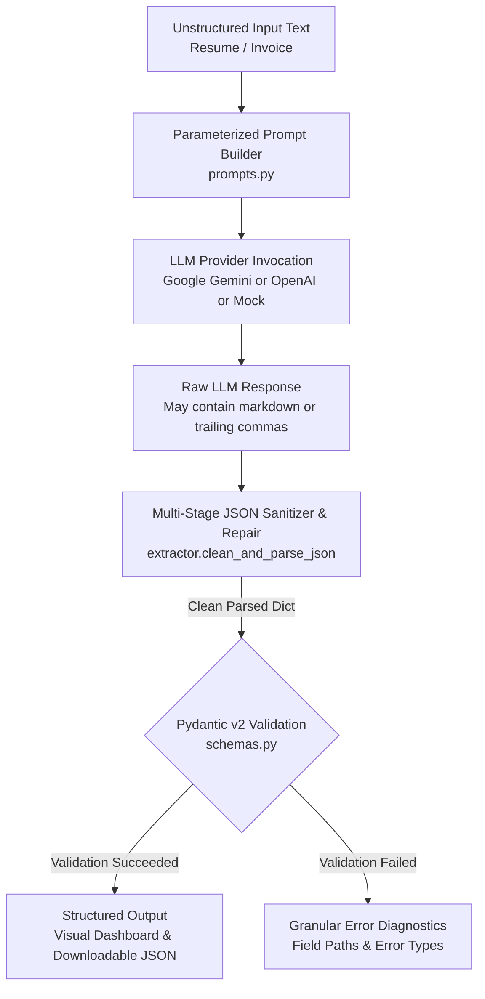

# Task 1: Structured LLM Prompt Pipeline & JSON Extractor

A production-grade pipeline and interactive Streamlit web application that converts unstructured text (such as resumes, CVs, and invoices) into strictly validated, schema-compliant JSON payloads using Google Gemini / OpenAI and **Pydantic v2**.

---

## 📌 Problem Statement

Real-world unstructured documents (resumes, vendor bills, emails, and PDFs) lack standardized formats, contain noisy OCR artifacts, have missing attributes, and use varying date and currency representations. Traditional regex or rule-based parsers are brittle and fail whenever formatting shifts.

While Large Language Models (LLMs) excel at semantic comprehension, vanilla LLM outputs suffer from:
1. **Conversational Chaff:** Preambles like `"Here is the JSON you requested:"` or markdown fences (````json ... ````).
2. **Syntax Flaws:** Trailing commas in arrays/objects, unescaped quotation marks, or unquoted keys.
3. **Hallucinated or Missing Fields:** Omitting critical mandatory fields or inventing false data.
4. **Data Type Mismatches:** Returning currency strings (`"$1,500.00"`) instead of numeric floats (`1500.0`).

**Our Solution:** A resilient, 4-stage extraction pipeline featuring parameterized prompt templates, dual LLM provider support (Google Gemini & OpenAI), a multi-stage JSON sanitization and repair engine, and strict Pydantic v2 schema validation with granular field error diagnostics.

---

## 🏗️ Architecture & Workflow



### 4-Stage Extraction Pipeline:
1. **Prompt Engineering & Parameterization (`prompts.py`):** Combines role-defining system prompts, explicit JSON schema definitions, numeric stripping constraints, and the raw text into a single prompt.
2. **Provider Call (`extractor.call_llm`):** Queries Google Gemini (`google-genai` SDK with `response_mime_type="application/json"`) or OpenAI (`openai` SDK with `response_format={"type": "json_object"}`). Includes an offline **Mock Mode** for instant 0-cost local evaluation.
3. **JSON Sanitization & Repair (`extractor.clean_and_parse_json`):**
   - Strips ````json ```` markdown code fences.
   - Trims extraneous conversational preambles and postambles via regex brace matching (`{...}`).
   - Repairs invalid trailing commas before closing braces (`,\s*}` -> `}`) and brackets (`,\s*]` -> `]`).
   - Normalizes unescaped characters.
4. **Pydantic Schema Validation (`schemas.py`):** Enforces data contracts for `ResumeSchema` and `InvoiceSchema` with field validators that automatically coerce currency strings (e.g. `"$12,500.00"` -> `12500.0`).

---

## 🛠️ Technology Stack

| Component | Library / Framework | Purpose |
|---|---|---|
| **Language** | Python 3.10 - 3.13 | Core programming runtime |
| **Data Validation** | `pydantic >= 2.7.0` | Strongly-typed schemas, field validators, type coercion |
| **LLM Provider 1** | `google-genai >= 0.1.0` | Official Google Gemini API client |
| **LLM Provider 2** | `openai >= 1.30.0` | Official OpenAI API client |
| **Configuration** | `python-dotenv >= 1.0.0` | Secure environment variable handling |
| **Frontend UI** | `streamlit >= 1.35.0` | Interactive web dashboard with metrics and cards |
| **Testing** | `pytest >= 8.0.0` | Automated unit testing & regression suite |

---

## ⚙️ Installation & Setup

### 1. Clone & Navigate to Workspace
```bash
cd d:\Projects\Datheon_Internship
```

### 2. Activate Virtual Environment
```bash
# Windows PowerShell
.venv\Scripts\Activate.ps1

# Windows CMD
.venv\Scripts\activate.bat

# Linux / macOS
source .venv/bin/activate
```

### 3. Install Dependencies
```bash
pip install -r requirements.txt
```

---

## 🔑 Environment Variable Setup

Create a `.env` file in the root directory by copying `.env.example`:

```bash
cp .env.example .env
```

Populate your API keys:
```ini
# Google Gemini (Recommended - Free tier available at https://aistudio.google.com/)
GEMINI_API_KEY=AIzaSy...your_gemini_key

# OpenAI (Optional alternative)
OPENAI_API_KEY=sk-...your_openai_key

# Default Settings
DEFAULT_LLM_PROVIDER=gemini
GEMINI_MODEL=gemini-1.5-flash
OPENAI_MODEL=gpt-4o-mini
```

> **Security Note:** `.env` is explicitly included in `.gitignore` and is never committed to Git.

---

## 🚀 How to Run the Application

### Option A: Interactive Streamlit Web UI (Recommended)
Launch the interactive web application:
```bash
streamlit run task1_json_extractor/app.py
```
Open your browser at `http://localhost:8501`.

**Features in UI:**
- **Document Type Selector:** Switch between Resume Extractor, Invoice Extractor, and Custom Schema.
- **Provider Selector:** Switch between Google Gemini, OpenAI, or **Offline Mock Mode** (no API key required).
- **1-Click Sample Loaders:** Instantly populate realistic resumes and invoices.
- **Visual Presentation:** Clean metrics, skill badges, line-item tables, and downloadable JSON.

### Option B: Terminal CLI Runner
Run a quick terminal-based verification:
```bash
python task1_json_extractor/app.py --cli
```

---

## 📋 Example Inputs and Outputs

### Example 1: Resume Extraction

#### Raw Input Text Snippet:
```text
PRIYA SHARMA
AI & Full-Stack Python Engineer | Bengaluru, India | priya.sharma.dev@gmail.com | +91 98765 43210
LinkedIn: https://linkedin.com/in/priyasharma-ai

SUMMARY:
Results-driven AI Engineer with 3+ years of experience architecting LLM-powered applications and RAG pipelines.

SKILLS: Python, FastAPI, Streamlit, LangChain, ChromaDB, Google Gemini API

EXPERIENCE:
Senior GenAI Developer | Datheon Tech Solutions, Bengaluru (July 2022 - Present)
- Architected enterprise multi-agent system handling 15,000+ weekly requests.
- Engineered hybrid RAG pipeline with ChromaDB boosting accuracy to 94%.

EDUCATION:
B.Tech in Computer Science & Engineering | Vellore Institute of Technology (VIT) | Grad: 2021 | CGPA: 8.9 / 10.0
```

#### Validated JSON Output:
```json
{
  "candidate_name": "Priya Sharma",
  "headline": "AI & Full-Stack Python Engineer",
  "contact_info": {
    "name": null,
    "email": "priya.sharma.dev@gmail.com",
    "phone": "+91 98765 43210",
    "linkedin_url": "https://linkedin.com/in/priyasharma-ai",
    "github_url": null,
    "location": "Bengaluru, India"
  },
  "summary": "Results-driven AI Engineer with 3+ years of experience architecting LLM-powered applications and RAG pipelines.",
  "skills": [
    "Python",
    "FastAPI",
    "Streamlit",
    "LangChain",
    "ChromaDB",
    "Google Gemini API"
  ],
  "work_experience": [
    {
      "company": "Datheon Tech Solutions",
      "role": "Senior GenAI Developer",
      "location": "Bengaluru",
      "start_date": "July 2022",
      "end_date": "Present",
      "is_current": true,
      "responsibilities": [
        "Architected enterprise multi-agent system handling 15,000+ weekly requests.",
        "Engineered hybrid RAG pipeline with ChromaDB boosting accuracy to 94%."
      ],
      "technologies": ["Python", "LangChain", "ChromaDB"]
    }
  ],
  "education": [
    {
      "institution": "Vellore Institute of Technology (VIT)",
      "degree": "B.Tech in Computer Science & Engineering",
      "field_of_study": null,
      "graduation_year": 2021,
      "gpa": "8.9 / 10.0"
    }
  ],
  "projects": [],
  "certifications": []
}
```

---

## 🧪 Testing Instructions

Run the automated test suite with verbose output:
```bash
pytest tests/test_task1.py -v
```

### Test Coverage Highlights:
- `test_resume_schema_valid`: Verifies valid resume model creation.
- `test_resume_schema_empty_name_fails`: Validates rejection of empty candidate names.
- `test_invoice_schema_valid_and_coercion`: Verifies currency string cleaning (`"$1,500.00"` -> `1500.0`).
- `test_build_prompt_resume` & `test_build_prompt_invoice`: Tests prompt template parameterization.
- `test_clean_and_parse_json_markdown`: Tests stripping of ````json ```` fences.
- `test_clean_and_parse_json_trailing_commas`: Tests repair of illegal trailing commas.
- `test_clean_and_parse_json_with_preamble`: Tests regex extraction of JSON from conversational text.
- `test_extractor_resume_mock_success`: Full end-to-end extraction with mock LLM.
- `test_extractor_missing_required_field_handling`: Tests graceful error reporting for missing fields.
- `test_extractor_missing_api_key_handling`: Tests clean handling of missing or invalid API keys.

---

## ⚠️ Known Limitations & Design Trade-offs

1. **Context Window Limits:** Very long documents exceeding model context limits (e.g. 50+ page resumes) should be pre-chunked or summarized before JSON extraction.
2. **Ambiguous Date Formats:** Formats like `04/05/2023` can mean April 5 or May 4 depending on locale; the prompt instructs the model to preserve month names where possible.
3. **Multi-Currency Invoices:** The invoice schema defaults to a single primary currency code. Transactions spanning multiple currencies in line items are not supported in this version.
