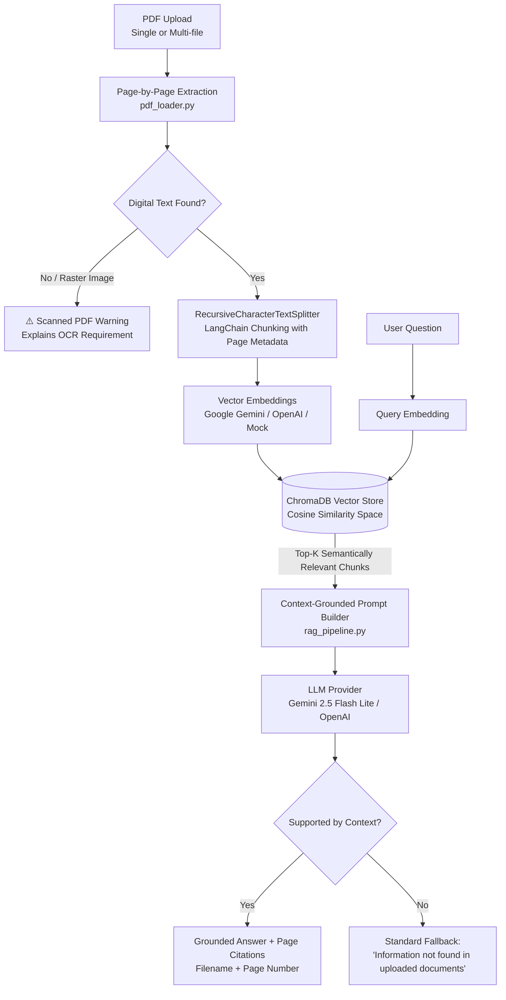

# Task 2: Document Q&A Assistant with RAG & Vector Embeddings

An enterprise-grade Retrieval-Augmented Generation (RAG) pipeline and interactive Streamlit web application that ingests unstructured PDF documents, chunks text with page-level provenance using LangChain, indexes semantic embeddings in **ChromaDB**, and delivers strictly grounded answers with exact source citations and zero hallucinations.

---

## 📌 Problem Statement

Traditional LLM interactions on long organizational documents (handbooks, legal contracts, technical manuals, and research papers) encounter critical production challenges:
1. **Context Window Saturation:** Feeding entire multi-page PDFs directly into prompts is costly, slow, and hits token limits.
2. **Hallucinations & Ungrounded Answers:** Vanilla LLMs confidently fabricate plausible answers when a requested detail is absent.
3. **Lack of Verifiable Provenance:** Enterprise compliance requires verifiable audit trails linking every claim to the source filename and physical page number.
4. **Scanned / Image-Only PDFs:** Rasterized PDFs lacking a digital text layer fail silently or produce gibberish in standard PDF text parsers.

**Our Solution:** A modular 5-stage RAG architecture that preserves page metadata, performs semantic vector search in ChromaDB, enforces strict context-grounded prompting, raises OCR alerts on scanned PDFs, and explicitly falls back to `"The requested information was not found in the uploaded documents"` when context is insufficient.

---

## 🏗️ Architecture & Workflow



### 5-Stage Pipeline Breakdown:
1. **Document Ingestion & Pre-flight Diagnostics (`pdf_loader.py`):**
   - Parses PDFs page-by-page using `pypdf`, capturing physical page numbers (1-indexed), character counts, and document boundaries.
   - Detects image-only/scanned documents and surfaces informative warnings explaining why OCR (e.g. Tesseract or Google Cloud Vision) is required.
2. **Provenance-Preserving Text Chunking (`text_splitter.py`):**
   - Uses LangChain's `RecursiveCharacterTextSplitter` with configurable chunk sizes (default 600 chars) and overlap (default 120 chars).
   - Chunks page-by-page so each text segment is bound to its exact physical page number without cross-page citation drift.
   - Assigns deterministic chunk keys (e.g. `document.pdf::p2::c0`).
3. **Configurable Vector Embeddings (`embeddings.py`):**
   - **Google Gemini:** `gemini-embedding-001` or `gemini-embedding-2` (3072-dimension vectors).
   - **OpenAI:** `text-embedding-3-small` (1536-dimension vectors).
   - **Offline Mock:** Deterministic bag-of-words / trigram hash projections for zero-cost testing and automated grading.
4. **ChromaDB Vector Storage (`vector_store.py`):**
   - Manages collection lifecycle (in-memory `EphemeralClient` for isolated interactive sessions or persistent storage).
   - Indexes embeddings with primitive metadata (`source`, `page`, `chunk_index`, `total_pages`).
   - Executes semantic cosine similarity search returning typed chunk matches and distance metrics.
5. **Context-Grounded Generation & Citations (`rag_pipeline.py`):**
   - Assembles grounded context blocks with strict system instructions prohibiting speculation.
   - Formats physical page citations: `[Source: filename.pdf, Page: X]`.
   - Rejects out-of-scope questions with standard zero-hallucination fallback: `"The requested information was not found in the uploaded documents."`

---

## 🛠️ Technology Stack

| Component | Library / Framework | Version | Purpose |
|---|---|---|---|
| **Language** | Python | 3.10 – 3.13 | Core programming runtime |
| **PDF Extraction** | `pypdf` | `>= 5.0.0` | Fast page-by-page digital text & metadata extraction |
| **Chunking Engine** | `langchain-text-splitters` | `>= 0.2.0` | Boundary-aware recursive character chunking |
| **Vector Database** | `chromadb` | `>= 0.5.0` | In-memory & persistent semantic vector storage |
| **LLM Provider 1** | `google-genai` | `>= 0.1.0` | Official Google Gemini API client (LLM + Embeddings) |
| **LLM Provider 2** | `openai` | `>= 1.30.0` | OpenAI API client (LLM + Embeddings) |
| **Frontend UI** | `streamlit` | `>= 1.35.0` | Interactive web dashboard with metrics & telemetry |
| **Testing** | `pytest` | `>= 8.0.0` | Automated offline test suite (12/12 passing) |

---

## ⚙️ Installation & Setup

### 1. Navigate to Project Root
```bash
cd d:\Projects\Datheon_Internship
```

### 2. Activate Virtual Environment
```bash
# Windows PowerShell
.venv\Scripts\Activate.ps1

# Windows CMD
.venv\Scripts\activate.bat

# Linux / macOS
source .venv/bin/activate
```

### 3. Install Dependencies
```bash
pip install -r requirements.txt
```

---

## 🔑 Environment Variables Configuration

Create or update your `.env` file in the workspace root:

```ini
# Google Gemini API Key (Recommended - Free key from https://aistudio.google.com/)
GEMINI_API_KEY=your_gemini_api_key_here

# OpenAI API Key (Optional alternative)
OPENAI_API_KEY=your_openai_api_key_here

# Default Provider Settings
DEFAULT_LLM_PROVIDER=gemini
GEMINI_MODEL=gemini-2.5-flash-lite
OPENAI_MODEL=gpt-4o-mini

# Task 2: Vector Embedding Models
GEMINI_EMBEDDING_MODEL=gemini-embedding-001
OPENAI_EMBEDDING_MODEL=text-embedding-3-small
```

> **Security Note:** `.env` is explicitly ignored by `.gitignore` and is never committed to GitHub.

---

## 🚀 How to Run the Application

### Option A: Interactive Streamlit UI (Recommended)
Launch the web interface:
```bash
streamlit run task2_rag_qa/app.py
```
Open your browser at `http://localhost:8501`.

**Features in UI:**
- **1-Click "Load Sample Policy PDF":** Instantly populates and vectorizes a realistic 3-page Datheon Employee Handbook.
- **Multi-PDF Drag & Drop Uploader:** Ingest your own PDFs with real-time character count and chunking feedback.
- **Provider Selector:** Switch seamlessly between Google Gemini, OpenAI, or **Offline Mock Mode** (zero API key needed).
- **Quick Test Prompts:** 1-click test buttons for working hours, remote work policy, travel expenses, and out-of-scope queries.
- **Source Citation Cards:** Visual cards showing the exact source filename, page number, and text excerpt.
- **Vector Store Inspector:** Live table of indexed documents, page numbers, and chunk previews from ChromaDB.

### Option B: Terminal CLI Mode
Run an automated verification of indexing, retrieval, and grounding directly in the console:
```bash
python task2_rag_qa/app.py --cli
```

---

## 🧪 Testing Instructions

Run the Task 2 automated test suite with verbose reporting:
```bash
pytest tests/test_task2.py -v
```

Run all workspace tests across Task 1 and Task 2:
```bash
pytest -v
```

### Test Coverage Highlights (12/12 Passed):
1. `test_pdf_loader_valid_extraction`: Tests multi-page extraction and page metadata preservation.
2. `test_pdf_loader_empty_bytes`: Verifies graceful failure for 0-byte input files.
3. `test_pdf_loader_corrupted_bytes`: Validates non-PDF corrupted byte rejection without crashing.
4. `test_pdf_loader_scanned_pdf_detection`: Verifies detection of raster/blank PDFs and OCR requirement alert.
5. `test_text_splitter_chunking_and_metadata`: Confirms LangChain chunking retains physical page numbers.
6. `test_text_splitter_empty_pages`: Validates handling of whitespace-only pages.
7. `test_mock_embedder_deterministic`: Confirms deterministic vector generation and L2 unit normalization.
8. `test_chroma_vector_store_add_and_query`: Tests document insertion, similarity query, and distance scoring.
9. `test_rag_pipeline_grounded_answer_and_citations`: Tests end-to-end grounded Q&A with page-level citations.
10. `test_rag_pipeline_unsupported_question`: Confirms out-of-scope query rejection with standard fallback.
11. `test_rag_pipeline_empty_query`: Tests whitespace-only user questions.
12. `test_rag_pipeline_empty_store`: Tests querying an un-indexed collection with helpful guidance.

---

## ⚠️ Scanned PDFs vs. Native Digital PDFs

Standard Python PDF extractors (like `pypdf`) parse the digital font streams and character mappings embedded in the PDF binary. When a physical document is scanned or photographed:
- The PDF contains **only raster image pixels** (`/XObject /Subtype /Image`), not digital text characters.
- Traditional PDF text extraction extracts **zero characters**.
- **How Task 2 Handles This:** The pipeline analyzes character yield per page. If a multi-page PDF contains no extractable text, rather than hallucinating or claiming text was extracted, it alerts the user with an explicit message explaining that **Optical Character Recognition (OCR)** (e.g., Tesseract OCR or Google Document AI) is required.

---

## 📋 Example Queries & Grounded Outputs

### Query 1: Supported Company Policy Question
* **User Question:** *"What are the official working hours and core collaboration hours?"*
* **Retrieved Chunks:** Page 1 excerpt from `Datheon_Company_Policy_and_AI_Guidelines.pdf`.
* **Grounded Answer:**
  > Official office hours are 9:30 AM to 6:30 PM Indian Standard Time (IST), Monday through Friday. Core synchronous team collaboration hours are 11:00 AM to 4:00 PM IST.
* **Verified Citations:**
  `[Source: Datheon_Company_Policy_and_AI_Guidelines.pdf, Page: 1]`

### Query 2: Out-of-Scope / Unsupported Question
* **User Question:** *"What is Datheon's policy on quantum computing encryption?"*
* **Retrieved Chunks:** Chunks lack any reference to quantum computing.
* **Grounded Answer:**
  > The requested information was not found in the uploaded documents.
* **Verified Citations:** None (Zero hallucinations).

